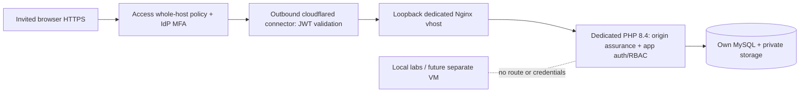

# Cloudflare private-beta configuration plan

**No Cloudflare API/dashboard/CLI account operation or DNS change was performed.** Team/domain/IdP/plan/identities/tunnel IDs are UNKNOWN. All example hostnames are reserved placeholders. This is a proposed remotely managed tunnel configuration, not credentials or an applied route.

## Target and order of operations

First approve inventory and code prerequisites; rehearse origin privately; create/configure the Access application and deny-by-default identities **before** publishing its hostname. A tunnel without an Access policy would not make the app private. Use distinct staging/beta tunnels, origin ports, Access applications/audiences, tokens and operator ownership. Do not reuse an unrelated household tunnel or add wildcard routes to existing services. [Tunnel setup](https://developers.cloudflare.com/cloudflare-one/networks/connectors/cloudflare-tunnel/get-started/).

## Desired Access policy

| Setting | Staging / beta proposal |
| --- | --- |
| App | Self-hosted, exact approved hostname, **all paths**, not a path-only login screen |
| Allow | Explicit invited emails or a reviewed IdP group; no Everyone/BYPASS/public email-domain wildcard |
| MFA | Enforce through the approved IdP and supported Access authentication requirement; verify actual IdP/session behavior. Email OTP alone is not an MFA assumption |
| Session | Proposed 8 hours for beta edge session; shorter staff policy if available; application session remains 120 minutes, sensitive reauth 15 minutes |
| Deny | Uninvited/removed identities; unmatched users get no access |
| Machine monitor | Separate expiring Service Auth policy/token only if needed; no public `/ready` bypass; still no app-user session or DB privileges |
| Studio | Laravel RBAC remains mandatory; optional stricter staff Access application requires separate path-specificity/normalization tests |

Include criteria combine as OR while Require narrows them as AND; do not accidentally put a mandatory identity/MFA restriction in another Include row. Plan selectors/features must be checked against the actual account/IdP. [Access policy semantics](https://developers.cloudflare.com/cloudflare-one/access-controls/policies/).

Access identity and VulnLab identity are separate. Do not auto-create an application admin from an Access email/header. Closed enrollment C03 must exist before beta. Removal requires both Access revocation and, where appropriate, application suspension/session invalidation. Test Access expiry during autosave without losing drafts or claiming success.

## Tunnel connector and origin

Desired configuration is in [cloudflare-remote-config.json.example](templates/cloudflare-remote-config.json.example). It contains exact whole-host rules for staging/beta with fixed `httpHostHeader`, Access JWT validation and a final 404 catch-all; remove the unused environment's rule when using separate tunnels. No route for aaPanel, SSH, phpMyAdmin, MySQL, 8088, 8090, Docker or vulnerable labs. Never publish a broad LAN/private-network route as part of this task.

`originRequest.access.required`, team name and audience list make the connector validate the assertion before proxying. A request header's presence alone is not authentication. [Origin parameters](https://developers.cloudflare.com/cloudflare-one/networks/connectors/cloudflare-tunnel/configure-tunnels/origin-parameters/), [Access application token validation](https://developers.cloudflare.com/cloudflare-one/access-controls/applications/http-apps/authorization-cookie/application-token/).

The example uses HTTP on a dedicated **same-host loopback** origin, with browser-to-edge HTTPS. This is not `noTLSVerify`. If the connector and origin are moved to different hosts, require reviewed authenticated TLS/private networking; for HTTPS origins specify the correct server name/CA and retain certificate verification. Do not fix certificate errors by disabling verification. Do not point at the existing local development 8088 server.

**Co-host/origin bypass:** a loopback port is reachable by other local processes, and Access at the edge cannot protect a direct origin request by itself. C02 requires verified origin assurance (fixed issuer/audience/signature/time, bounded trusted JWKS lookup/cache, deny missing/forged/expired assertions) or an explicitly approved equivalent isolation control. Separate FPM/connector identities and private file permissions are required. A shared root/kernel remains a trust boundary; untrusted co-hosts may require a dedicated VM. This is a deployment blocker, not already-implemented middleware.

### HTTPS and client-IP handling

The Nginx template discards caller-supplied Forwarded/forwarded-host values, sets the expected HTTPS scheme/443 for this HTTPS-only origin, and forwards the single edge CF-Connecting-IP value instead of trusting an arbitrary XFF chain. Laravel must trust only the actual loopback proxy and intended header mask, and only exact approved hosts. Do not set proxies to `*`; `APP_URL` alone does not implement this. [Laravel trusted proxies/hosts](https://laravel.com/docs/12.x/requests#configuring-trusted-proxies).

Prove forged headers at the external edge cannot alter the application scheme, host, signed URLs or observed client IP; test two actual clients, untrusted direct-origin requests, and Access valid/invalid tokens. Review Workers/Pseudo-IPv4 settings and any existing global Nginx real-IP directives before accepting the header model. Bypass is not considered closed until tested on the actual chain.

Set Cloudflare caching to bypass authenticated HTML/Inertia/API/private media and preserve `no-store`/`Vary`; never enable a Cache Everything rule for this hostname. Only immutable hashed build assets may be cached. Prove two users cannot receive one another's cached responses. Use HTTPS-only browser entry; review redirect/HSTS carefully and do not enable broad `includeSubDomains`/preload for unrelated home domains.

### Connector service

[cloudflared.service.example](templates/cloudflared.service.example) is a proposed per-environment systemd unit. Use a protected token file via systemd credentials; never paste tokens into command arguments, logs, PRs or `.env` examples. Confirm systemd credential support and installed binary path before use. Remotely managed `--token-file` requires cloudflared 2025.4.0 or later; select a currently supported patched build during approval. No binary was installed or tunnel started here. [Run parameters](https://developers.cloudflare.com/cloudflare-one/networks/connectors/cloudflare-tunnel/configure-tunnels/run-parameters/).

No inbound router forwarding is needed for a tunnel. Inventory existing IPv4/IPv6 exposure and co-host rules before any future firewall change. Approved egress must support Cloudflare tunnel destinations on UDP 7844 (QUIC) or TCP 7844 (HTTP/2), plus required DNS/time/package operations under the host policy; use the current official destination list rather than a stale copied firewall range. [Firewall requirements](https://developers.cloudflare.com/cloudflare-one/networks/connectors/cloudflare-tunnel/configure-tunnels/tunnel-with-firewall/).

Bind connector metrics explicitly to loopback (proposed 20241 staging / 20242 beta), not a default container-wide listener. Monitor locally without publishing metrics. [Metrics reference](https://developers.cloudflare.com/cloudflare-one/networks/connectors/cloudflare-tunnel/monitor-tunnels/metrics/).

## Future external acceptance — NOT RUN

From outside the LAN after publication approval: invited/uninvited/removed identity; MFA and session expiry; absent/forged JWT; wrong audience; wrong Host/scheme/XFF; direct origin/LAN reachability; no panel/tools/lab routes; TLS/signed exports/cookies/CSRF; cache separation; app role boundaries; connector failure and Access fail-closed. Do not disable Access while debugging. Revoke only this environment's token/route on rollback, preserving unrelated tunnels/DNS.
