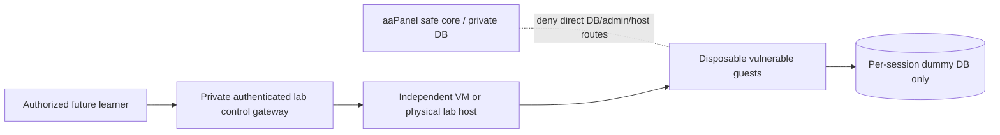

# Lab isolation and hosted beta mode

## Current evidence and hard boundary

Eight runtimes and an isolated Chromium verifier exist **locally**. Sprint 6 [containment evidence](../lab-isolation-check.json) and [runtime results](../qa/command-results.json) are local Docker observations; they are not certification of an Internet-facing lab host. The accepted P2 is a single-render verifier: contention safely returns 503, and public-user capacity/abuse testing has not been done.

**No lab workload, runner token/control token, Docker socket, sandbox Compose overlay, executable scenario or lab network is to be deployed on the aaPanel production host.** No labs were started/stopped, republished or moved as part of this planning sprint. Existing local lab setup remains unchanged and private.

## Hosted beta core

Use `LABS_ENABLED=false` and no runner URL/token, without altering historical `lab_progress`, XP, attempts or curriculum. Catalog/theory links remain useful, but hosted live actions must clearly state **Lab tidak tersedia pada beta**. Current source has generic unavailable text and availability flags; C04 must complete hosted-state behavior and tests before beta.

Current `LabController::show` can serialize an existing session's fixtures, and adapter supports only `127.0.0.1:8090` / `lab-runner:8090`. Do not import active runtime credentials blindly or assume changing the URL enables a remote host. In beta-disabled mode the proposed patch must suppress active session fixtures/controls and reject **all** start/request/flag/reset/stop/hint mutations before any runner call, while preserving historical solves/read-only evidence. Test imported legacy sessions, no-session users, forged flags and repeat rewards. Use `Http::preventStrayRequests`/adapter spies with disabled-mode tests; no call to a real runner is acceptable. No session reset or learner-data deletion is needed to prove the policy.

Deploy only the core artifact/public assets; exclude `sandbox/`, root dev Compose/overlay, test fixtures/traces, `.env`, backups, dependency caches and local tools from the target release payload. The aaPanel native document root is `/public`, not the repository. No reverse proxy/tunnel route to 8090 or any vulnerable endpoint; no privileged runtime API from PHP. Network-level egress controls should also deny core-to-lab/control/host management segments except explicitly approved future architecture, not rely solely on an environment flag.

## Separate future lab environment — NOT approved or implemented

A separate kernel/VM/physical host is required; a second container on the aaPanel host is not this boundary. Treat a compromised vulnerable guest and Chromium process as expected threats. Use independent credentials, networks, storage, dummy users and session secrets. No production env, SSH keys, backup mounts, Docker socket, hostPath/bind mounts, privileged/host networking or general shell/URL execution API.

Plan default-deny ingress/egress on the lab host: block home LAN, core app/admin/MySQL, aaPanel, Docker API, host gateway and metadata routes, IPv4/IPv6 and DNS-rebinding alternatives. Allow only specifically reviewed gateway-to-runtime control and essential isolated DNS/time if needed. Enforce request endpoint/method/body/header allowlists after normalization; reject redirects or revalidate every hop. Runtime reset rotates generation/secrets and disposes only per-session fixtures. Bound memory, CPU, PIDs, disk, request/response size, execution/session duration and global/per-user concurrency; nonroot/read-only/capability drops/seccomp/AppArmor where supported.

The trusted control gateway must have no production DB or host-admin privileges. Authenticate capabilities with expiry/owner/generation and least-privilege transport; use private authenticated TLS across hosts and no public unauthenticated runner. Add a reviewed adapter/protocol implementation and tests rather than weakening the existing fixed URL allowlist. Browser verifier currently uses `--no-sandbox` inside its restricted local container; review kernel/browser isolation anew. Do not claim containers or distroless eliminate escape risk.

Before any future enablement: independent threat review, current image/package CVE scan and SBOM/digest provenance, kernel hardening, controlled positive/negative network probes, real SSRF/redirect/IPv6/DNS tests, two-user concurrency/abuse/quota/timeout tests, orphan cleanup, post-reset secret invalidation, once-only XP under races, incident kill switch and restore drill. Audit image tags (currently mutable), limits, mounts and no credential leakage. No scanners were installed or images pulled in this planning task. These tests must not probe unowned external targets or reset the learner DB.

Disposition of S6-013: **accepted for local serial use; blocks hosted multi-user labs**. A future separate lab-host design/implementation/approval is required; core private-beta approval never implies lab approval.
