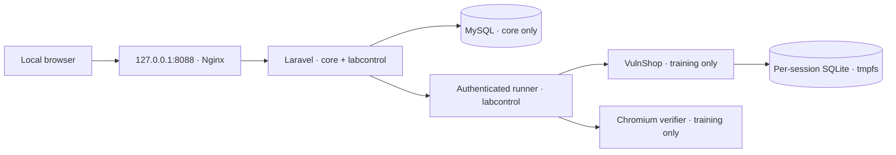

# Local VulnShop isolation — Sprint 3

The secure Laravel platform and deliberately vulnerable VulnShop run as different Compose projects. The main image excludes the entire `sandbox/` directory. There is no Docker socket, shell-command orchestration, arbitrary URL proxy, or deliberately vulnerable endpoint in Laravel.



`sandbox/compose.yaml` creates `vulnlab-sandbox_training` and `vulnlab_labcontrol` as internal networks. VulnShop and the browser verifier join **training only**. Neither exposes a host port. No core files, users, cookies, database passwords, APP_KEY, or storage volumes are shared with them.

The trusted runner joins training and control. It also has an edge bridge so Docker can publish its authenticated API at **127.0.0.1:8090** for host-based local development/tests. Internal-only Docker networks did not publish a reachable loopback port in this environment; the edge bridge is limited to the trusted runner. Its HTTP destinations are fixed (`shop:8080`, `verifier:8091`); it rejects redirects, user-selected URLs and commands. It never forwards its own authentication token to a training endpoint. OS-level egress is available to this trusted component; the vulnerable shop and verifier have internal networking and passed external TCP denial probes.

Core MySQL stays on `vulnlab_core`; Nginx is not on control/training. The optional core overlay adds only Laravel to control. The base Compose configuration remains usable with labs disabled. Execution is guarded by `LABS_ENABLED`; the catalog/instructions remain readable without a running sandbox and show actionable unavailable/error states.

## Local startup

Create the usual core `.env`, key and database passwords as described in README. Then:

```sh
node scripts/setup-labs.mjs
docker compose --env-file sandbox/.env -f sandbox/compose.yaml up -d --build
docker compose -f compose.yaml -f compose.labs.yaml build app web
docker compose -f compose.yaml -f compose.labs.yaml run --rm app php artisan migrate --seed --force
docker compose -f compose.yaml -f compose.labs.yaml up -d
```

Open `http://127.0.0.1:8088/labs`. Nothing is deployed to aaPanel or a public host. The setup helper prepares dedicated local credentials in ignored `.env` files without printing them. Keep the root and sandbox runner tokens consistent. Never reuse APP_KEY or database credentials as runner secrets. For PHP running directly on the host, set `LABS_ENABLED=true`, `LAB_RUNNER_URL=http://127.0.0.1:8090` and the generated runner token in its environment. Docker uses the fixed `http://lab-runner:8090` URL from the overlay.

Stop only the training environment with:

```sh
docker compose --env-file sandbox/.env -f sandbox/compose.yaml down
```

No `-v` or core database reset is required. Recreating the shop container discards its temporary fixtures. A core session whose fixture disappeared receives an expired/restarted error; Reset recreates it with a new generation/flag. Historical completion and XP remain in MySQL.

## Session and validation boundary

Each user/lab pair has one reusable core session with UUID, generation, one-hour lease, encrypted capability/flag secret and SHA-256 flag hash. Flags contain 192 random bits and are not shipped in seeds, lesson payloads or bundles. The shop uses a separate management record and SQLite file per UUID, containing only dummy resources. Capability/generation checks scope every request. At most 64 fixtures are active; expired data is removed.

Start is idempotent for an active generation; provisioning failures retain retryable error state. Reset rotates the capability/flag and recreates only that session's fixtures; stale requests fail with 409. Expired/stopped sessions reject requests/flags. Core attempts store success, generation and submission UUID, without submitted flag plaintext. Submission requires both the flag hash match and sandbox evidence. Unique constraints and user/session locks protect first completion and XP. Hints are separate and survive reset. A browser checklist cannot award completion.

The editor selects a named endpoint from `database/data/lab-routes.json`; the runner independently uses byte-identical `sandbox/contracts.json`. Both boundaries check methods, headers and body sizes. Host, application cookies, capability/management headers, unknown endpoints and redirects are rejected. GET JSON is encoded as query parameters. Requests have time/response-size limits; only the owner's history is returned.

## Vulnerable runtime constraints

- All three sandbox services run as user `node`, with read-only roots, dropped capabilities, no-new-privileges, CPU/memory/PID limits and bounded tmpfs. There are no host bind mounts, Docker sockets or shared core volumes.
- SQL injection runs a real SQLite query against the session's products. An authorizer blocks other tables, filesystem/extension functions, schema changes and recursive queries around the intentionally unsafe query. Secure mode uses parameters.
- XSS verification runs in a separate Chromium container. It receives the actual returned HTML, blocks browser network routes, applies restrictive CSP and exposes only a dummy `labProof()` callback. The runner records proof and releases a flag after that callback executes. The core renders HTML responses as escaped, highlighted source.
- Chromium uses `--no-sandbox` inside the restricted container, a known local MVP limitation. The verifier has no secrets, host mounts, published ports, control network or core access. Hardened VM/container-per-learner execution is required before hostile multi-user/public operation.
- VulnShop's management credential is a dedicated sandbox credential shared only with the trusted runner. It is not a production/core secret. Browser requests cannot set its header or select management routes.

## Executed checks and future runner

Run `node scripts/test-sandbox.mjs` for real baseline/exploit/secure/reset/evidence/expiry tests across all eight labs. Run `node scripts/check-lab-isolation.mjs` for Docker inspection/TCP probes; it writes [lab-isolation-check.json](lab-isolation-check.json). The probes check database access by name/address and one external TCP destination from shop and verifier. They complement the network configuration and are not a full penetration test.

`App\Contracts\LabRunnerAdapter` defines provision, request, evidence and stop for a future separate VM/host implementation. A future adapter needs mutually authenticated transport, a fixed administrator-configured endpoint, per-learner execution isolation and the same bounded route contract. No remote deployment or generic host selection is implemented here.
