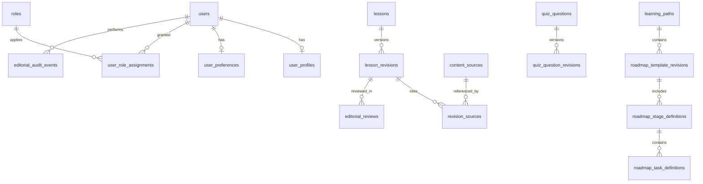

# VULNLAB V5 — DATABASE, API & AUTHORIZATION CONTRACT

## Read-first compatibility protocol
These are **proposed additive contracts**, not instructions to create duplicate tables. Before implementing, inspect existing `users`, `learning_paths`, `modules`, `lessons`, `quizzes`, `labs`, `roadmaps`, `notes`, `reports`, `xp_transactions`, `user_preferences`, `sessions`, `roles`, and any existing media upload table. Write a compatibility table mapping each V5 requirement to current implementation; extend existing entities safely. Do not run `migrate:fresh`, `db:wipe` or destructive seeders. Avoid eager third-party auth packages that conflict with the installed stack.

## Entity relationship overview

The diagram uses logical table names. Adapt to existing schema. `lessons` may be content records of type `lesson` instead of a new table.

## Additive model suggestions

| Table | Columns | Constraints / safeguards |
|---|---|---|
| `user_profiles` | `user_id` PK/FK, `username` nullable, `display_name`, `bio`, `avatar_disk`, `avatar_path`, timestamps | username normalized unique; avatar private/approved public only; no redundant email |
| `user_preferences` | `user_id` PK/FK, `theme`, `locale`, `timezone`, `reduced_motion`, `density`, `profile_visibility`, timestamps | valid IANA timezone, enum theme; default private |
| `user_notification_preferences` | `user_id`, `channel`, `event_type`, `enabled`, timestamps | unique user/channel/event; no dead switches |
| `roles` | `id`, `code`, `label` | stable unique role code; reuse existing if present |
| `user_role_assignments` | `user_id`, `role_id`, `granted_by`, `granted_at` | unique pair; guarded grants; no self-escalation |
| `content_sources` | `id`, `canonical_url`, `title`, `publisher`, `source_kind`, `license_notes`, `last_checked_at` nullable, timestamps | URL safe, no arbitrary server fetch; unique normalized URL if feasible |
| `lesson_revisions` | `id`, `lesson_id`, `revision_no`, `title`, `slug`, `summary`, `difficulty`, `estimated_minutes`, `body_markdown`, `objectives_json`, `prerequisites_json`, `status`, `created_by`, `approved_by` nullable, `published_at` nullable, `lock_version`, timestamps | unique lesson/revision_no; author/reviewer workflow; sanitize on render; no cycles |
| `revision_sources` | `revision_id`, `source_id`, `claim_notes` nullable | unique revision/source; provenance per version |
| `editorial_reviews` | `id`, `revision_id`, `reviewer_id`, `decision`, `review_notes`, `rubric_json`, `reviewed_at` | scoped permissions; reviewer != author by default |
| `editorial_audit_events` | `id`, `actor_user_id`, `target_type`, `target_id`, `event_code`, `before_summary_json`, `after_summary_json`, `created_at` | redact secrets; append-only; index actor/event/time |
| `quiz_question_revisions` | `id`, `question_id`, `revision_no`, `stem`, `choices_json`, `answer_key_private`, `feedback_json`, `status`, `created_by`, timestamps | answer key never exposed learner-side; historical results tied to question revision |
| `roadmap_template_revisions` | `id`, `template_id`, `revision_no`, `status`, `published_at`, `created_by`, timestamps | published snapshot immutable, historical user plans unchanged |
| `roadmap_stage_definitions` | `id`, `template_revision_id`, `title`, `position`, `unlock_rule_json` | deterministic ordering and checks |
| `roadmap_task_definitions` | `id`, `stage_id`, `kind`, `content_type`, `content_id`, `duration_minutes`, `position`, `prerequisite_ids_json` | FK/validated refs, no cycles, preserve existing enrolled tasks |
| `account_data_requests` | `id`, `user_id`, `kind`, `state`, `requested_at`, `completed_at`, `expires_at`, `private_export_path` | idempotency/rate limits; private storage; no secrets |
| `user_security_events` | `id`, `user_id`, `event_code`, `device_label`, `occurred_at`, `metadata_json` | no token/IP exposure in learner public props; retention policy |

**Critical compatibility notes:**
1. Existing production-like `lessons` may include `body` and `status`; add `published_revision_id` pointer only after backfilling compatible immutable initial revisions. Do not alter completion foreign keys.
2. If progress tables refer to a version ID instead of stable lesson ID, preserve original references and expose stable content identity via adapter. Do not reset learning progress on content edit.
3. If `theme` is already on `users`, reuse the field rather than create a duplicate preference source.
4. If session management already uses Laravel database sessions, use existing `sessions` table to revoke sessions; do not manually build insecure parallel session tokens.
5. If Fortify/Jetstream already supports TOTP, integrate with the current capabilities. If not, implement a fully audited compatible flow or explicitly defer/hide 2FA UI; no fake enable switches.
6. User email remains in `users`; any email-change request should use existing verified-change support or additive pending email with confirmation token stored hashed and time-limited.
7. Do not put correct answer keys, internal review notes or flags in public Inertia props.

## Authorization model: RBAC + Laravel policies
Recommended permission identifiers:
```
studio.access
content.read_draft
content.create
content.edit_draft
content.submit_review
content.review
content.publish
content.archive
quiz.edit_draft
lab_metadata.edit_draft
roadmap.edit_draft
users.read_limited
users.manage_status
users.manage_roles
reports.review_internal
audit.read
```
Defaults: `learner` = none, `editor` = `studio.access` + edit/submit, `reviewer` = `studio.access` + draft read/review, `admin` = all listed permissions with additional recent reauth for sensitive operations. Separation of duties for self-review. Never use `auth()->user()->role === 'admin'` scattered in UI as the sole security boundary; centralize permission checks in gates/policies, middleware + controller/actions, and tests. Disallow granting greater authority than actor possesses; last-active-admin removal requires a secondary trusted administrative process.

## Web and API route contract
**Keep compatible existing names where practical.** Names below describe expected capabilities, not mandatory URL rewrites.

### Admin Studio
| Method | Route | Permission | Contract |
|---|---|---|---|
| GET | `/studio` | `studio.access` | Server-authorized editorial counts and queue |
| GET | `/studio/content` | `content.read_draft` | Paginated permitted content |
| GET | `/studio/content/create` | `content.create` | New draft form |
| POST | `/studio/content` | `content.create` | Create stable lesson ID + draft revision |
| GET | `/studio/content/{lesson}/edit` | `content.edit_draft` | Draft editor; current lock version |
| PATCH | `/studio/content/{lesson}/revisions/{revision}` | `content.edit_draft` | optimistic versioned edit; reject stale version |
| POST | `/studio/content/{lesson}/submit-review` | `content.submit_review` | Validate prerequisites/sources then transition |
| POST | `/studio/reviews/{revision}/decision` | `content.review` | approve or changes-requested with notes |
| POST | `/studio/content/{lesson}/publish` | `content.publish` | atomically update published revision |
| POST | `/studio/content/{lesson}/archive` | `content.archive` | soft-hide public, preserve attempts/progress |
| GET | `/studio/quizzes` | `quiz.edit_draft` or reviewer read | list/question detail authorized |
| POST/PATCH | `/studio/quizzes/{question?}` | `quiz.edit_draft` | versioned question edit/validation |
| GET | `/studio/labs` | `studio.access` | catalog metadata only, no flag/secrets |
| PATCH | `/studio/labs/{lab}/metadata` | `lab_metadata.edit_draft` | draft metadata only |
| GET | `/studio/roadmaps` | `studio.access` | versioned templates |
| POST/PATCH | `/studio/roadmaps/...` | `roadmap.edit_draft` | safe stage/task editing |
| GET | `/studio/users` | `users.read_limited` | minimal data + aggregates |
| POST | `/studio/users/{user}/roles` | `users.manage_roles` + reauth | audited change; no self-promotion |
| POST | `/studio/users/{user}/suspend` | `users.manage_status` + reauth | protected account status |
| GET | `/studio/audit` | `audit.read` | scrubbed paginated events |

### Learner Profile / Settings
| Method | Route | Policy / validation | Contract |
|---|---|---|---|
| GET | `/profile` | authenticated owner | profile, achievements, aggregates, own privacy |
| GET | `/settings` | auth | redirect `/settings/general` |
| GET | `/settings/{section}` | auth + allowlisted section | page read, no secret values |
| PATCH | `/settings/general` | owner + validated | name, username, bio, locale, timezone |
| POST | `/settings/avatar` | owner, strict file validation | upload/crop safe avatar |
| DELETE | `/settings/avatar` | owner | delete avatar with consistency |
| PATCH | `/settings/appearance` | owner | theme, reduced motion |
| PATCH | `/settings/notifications` | owner | permitted delivery settings |
| POST | `/settings/security/password` | current password + reauth | change password; safe session policy |
| POST | `/settings/security/2fa/*` | support & reauth | actual TOTP lifecycle only if implemented |
| DELETE | `/settings/security/sessions/{session}` | owner + reauth as needed | revoke allowed session |
| PATCH | `/settings/privacy` | owner | private by default |
| POST | `/settings/data/export` | owner + reauth + rate limit | queued/private export request |
| POST | `/settings/data/delete-request` | owner + reauth + explicit confirmation | scheduled safe account removal |

**Form semantics:** Inertia+Laravel validation often redirects back with error bags rather than returning JSON 422. Respect the current installed Inertia version. JSON endpoints do return documented error envelopes and status codes; do not indiscriminately rely on one error handler for both.

**Error definitions:** `403` policy denial; `404` unknown/restricted resource where needed; `409` stale content version; `422` JSON validation; `429` rate-limit; `503` unavailable delivery/runtime. Errors must not leak secrets or stack traces. Success flash/toast only after verified server state. Never log password, TOTP, recovery code, API key or sandbox flag.

## Content publish transaction (pseudocode)
```text
BEGIN TRANSACTION
  LOCK lesson stable row
  ASSERT caller can publish
  ASSERT revision is approved and belongs to lesson
  ASSERT required sources/metadata verified and source review recorded
  UPDATE lesson.published_revision_id = selected_approved_revision
  SET revision published at current server time
  APPEND editorial audit event (metadata only)
COMMIT
Invalidate only affected published content cache
```
Do not allow `published_revision_id` in arbitrary mass-assignment from user request. Revision remains immutable once published.

## Quiz answer confidentiality
- `quiz_question_revisions.answer_key_private` never serialized in learner-facing props; use dedicated DTO/Resource output.
- Grading executes backend using versioned question ID from locked attempt session; record grade, correct explanation in result after submission according to quiz mode.
- Prevent tampering with XP/reward via client-supplied score or serialized correct answer.
- Staff preview that reveals keys is a separate admin-authorized endpoint and must not be cached on public proxy.

## Source URL and upload safety
- Do not server-fetch admin-entered URLs directly (SSRF). URLs are reference strings, with independent manual reviewer check.
- Avatar allow `image/png`,`image/jpeg`,`image/webp`, max e.g. 2 MB; verify real MIME, dimension limits, recompress/remove metadata in processor where available; SVG/HTML not accepted.
- Markdown `javascript:` links and raw HTML that could execute must be sanitized; source previews and exports must not execute script.
- Private export includes self-owned data, no auth secrets; signed downloadable expires and audit event records access.

## Testing seed fixtures (development only)
- `learner_a`, `learner_b` — distinct progress, notes/reports.
- `editor_a`, `editor_b` — separate draft updates.
- `reviewer_a` — reviews editor's content.
- `admin_a` — manage roles only under reauth.
- Two lessons: published IDOR revision 1 and draft IDOR revision 2.
- Two quiz versions with distinct answer keys.
- One lab runner unavailable; one test-only allowed lab.
- User A preference `dark, Asia/Jakarta`; User B `system, UTC`.
- All fixture credentials generated for local testing; no public known passwords; seeds gated by APP_ENV=local/testing.
