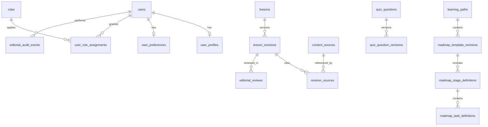

# VULNLAB — MASTER PRD V5 COMPLETE
**Admin Studio · Content CMS · User Profile · Settings · Security · QA**

> Engineering source of truth for V5 only. Existing V4 student design and V4.1 Progress/Reports remain authoritative for their screens. The detailed sections below are also provided separately for easy navigation.

## How to implement without rebuilding
1. Audit the existing repository and document what is present.
2. Preserve existing Laravel, Inertia React, TypeScript, MySQL and V4 routes.
3. Build Admin Studio and Profile/Settings with authorization first.
4. Validate all flows and preserve old learning/progress data.
5. Hosting/aaPanel remains deferred.

---


# PART — PRODUCT REQUIREMENTS

# VULNLAB — PRODUCT REQUIREMENTS DOCUMENT v5.0
## Admin Studio, Content CMS, User Profile & Settings — Implementation Contract

**Product:** VulnLab · Cybersecurity Learning Academy · Indonesia-first  
**Document version:** 5.0 · 24 Oktober 2026  
**Delivery phase:** Sprint 5 — Admin CMS & Account Experience  
**Status:** **Ready for engineering implementation; not proof of completed software**  
**UI source of truth for learner experience:** `references/visual-reference-v4.png` + existing V4/V4.1 PRD  
**Implementation stack:** Existing Laravel + Inertia React + TypeScript + Tailwind + MySQL  
**Release policy:** No public hosting/deployment in this sprint. Existing V4 learning/lab experience must remain functional. 

## 0. Executive decision
VulnLab currently has learning modules and notes; administration and profile/settings are under-specified. Build a complete, database-driven content management and account experience **without rewriting working learning features**. The content editor is an **internal, protected admin application** served by the **same Laravel monolith**, not a public CMS that can mutate sandbox code. The learner application **keeps its horizontal header, mountain roadmap, illustrated home, interactive labs and light/dark system**. A user-avatar menu leads to a polished Profile and Settings experience. An admin-only `Studio` entry leads to a modern editorial workspace.

**Design decision:** Reuse Inertia React and the existing design system for `/studio` rather than assuming Filament is already installed. If a compatible admin package is already present, the engineer must first document the tradeoff and avoid duplicate UX/data models. **No mandatory new Laravel UI framework** for this sprint.

### Problems solved
1. Learning content cannot be sustainably maintained by editing seeders/React files.
2. Editors need quality-control workflows, source provenance, previews, version history and publishing.
3. Quiz builders need safe authoring/assessment with correct answer confidentiality.
4. Lab metadata and hints need management without touching intentionally vulnerable container code.
5. Learners need real Profile, Preferences, Security, Notifications, Privacy and Data controls.
6. Admin privileges, user-owned notes/reports/progress, and published content need clear policy boundaries.
7. Feedback should be noticeable and actionable instead of a tiny banner at the top.

### Non-goals / hard boundaries
- **No hosting to aaPanel or Cloudflare Tunnel yet.** Deployment is the **final later phase**.
- Do not rebuild V4 screens or swap the existing architecture.
- No external live HackerOne/Bugcrowd posting or real third-party targets.
- The CMS edits **catalog metadata, tutorial text, hints, citations, difficulty and relationships**, but **never arbitrary Python/PHP/container commands, live target URLs, exploit code deployed on main host, Docker sockets, secrets, or server-executed user HTML**.
- No public user administration, public leaderboard or public profiles by default.
- No claims that content is expert-reviewed until a reviewer signs off.

## 1. Personas and navigation

| Persona | Goal | Allowed scope |
|---|---|---|
| Learner (`learner`) | Follow roadmap, labs, quizzes, notes, reports, personal account | Self-owned data and published material |
| Content Editor (`editor`) | Author lessons, quizzes, sources and non-executable lab descriptions | Create/edit drafts, cannot publish or manage user privileges |
| Content Reviewer (`reviewer`) | Check accuracy, references, readability and safety | Review/approve or request revision; publish only if explicitly granted |
| Platform Admin (`admin`) | Manage content, roles, catalog and operational controls | All administrative tools with policy and audit trail; cannot bypass isolation or view secrets |

**Default new user role:** `learner`. Distinguish `admin` account permission from sandbox training accounts; do not reuse lab dummy admin accounts for the core app.

**Learner navigation:** `Beranda · Roadmap · Modul · Lab · Progres · Catatan · Laporan` plus search, theme, notifications (only if functional), and avatar menu. Avatar dropdown: `Profil Saya`, `Pengaturan`, `Keamanan`, and `Keluar`, with `Admin Studio` only if authorized.

**Studio navigation:** `/studio` overview, `Konten`, `Kuis`, `Lab`, `Roadmap`, `Pengguna`, `Review`, `Audit`, `Pengaturan Studio` (last only if implemented). Desktop uses **top bar + workspace tabs**, with a **context tree only inside the editor page**, never a generic oversized admin sidebar. Mobile uses accessible tab navigation and drawers.

## 2. Core success metrics and launch gates
- Admin can create an original lesson, attach **real source URL(s)**, send for review, publish, and observe it in learner catalog **without code changes**.
- Editor cannot self-publish or change roles; reviewer cannot view private learner notes; learner receives **403** for all admin routes/APIs.
- Admin quiz editing retains correct-answer privacy: learners only receive allowed prompts/choices, and server grades attempts.
- Admin can edit lab *metadata* and hints, never sandbox runnable implementation or raw validation secrets.
- User can edit profile and preferences, change password (with confirmation), manage sessions, and request/export personal data via authenticated flows.
- Privacy preferences are applied server-side, not only hidden client-side.
- UI supplies visible validation, loading, success/error toasts and confirmation modals, with keyboard/screen-reader support.
- All affected features have tests executed, not just written. Source metadata and content versions are auditable.

## 3. Features & acceptance criteria

### F1 — Admin Studio Overview `/studio`
**Purpose:** Give administrators a reliable at-a-glance editorial view, not invented productivity numbers.

**UI:** Branded dark-navy header + light cards; page intro `Kelola pembelajaran VulnLab`, high-priority action `+ Materi Baru`; status counters: `Draft`, `Menunggu Review`, `Terbit`, `Perlu Perbaikan`; review queue with author, last edit, due date if actual; recently updated content table; quick actions for source checks/quiz/lab; audit activity preview. For all analytics use real DB counts; empty states with `Mulai buat materi`.

**Rules:** Only roles with `studio.access`. Preview mode calls policy checks. Counters scoped to authorized content if editing is per-team. Never show private learner reports or notes in broad dashboards.

**Acceptance (F1):** Unauthorized role → 403; counts match DB; empty table usable; navigation works desktop/mobile; no fake graphs.

### F2 — Course/Module/Lesson CRUD `/studio/content`
**Entities:** Learning Path → Module → Lesson → Lesson Blocks / References / Tags / Prerequisites. Map to existing DB rather than duplicate models.

**List view:** searchable, sortable, paginated and filterable by path, difficulty, editorial state, reviewer, last update; row actions `Edit`, `Preview`, `Duplicate draft`, `Archive`, with permission-specific visibility. Bulk archive/publish only if safely supported and audited.

**Editor:** structured lesson metadata (title, slug, summary, audience, estimated minutes, difficulty, expected outcomes, prerequisites, tags, related quiz/lab). Author-friendly Markdown with code syntax preview; optional structured blocks `paragraph | analogy | HTTP example | warning | exercise | remediation | source`. Responsive right rail `Sources & Quality Checks`: canonical source URL, authoring origin, fetched/verified date if actually checked, MITRE CWE/OWASP references when relevant, license notes, review status. Never claim auto fact-check by simply parsing a URL.

**Validation:** canonical slug unique in path/locale, nonempty title/outcomes/body, at least one valid relevant reference for security technical claims, realistic estimated duration >0, prerequisites cannot form cycles, status transitions role-protected, no accidental duplicate lesson IDs.

**Content UX:** autosave drafts with a visible `Menyimpan… / Tersimpan / Gagal menyimpan` status; explicit `Kirim Review` and later `Publikasikan` separate from autosave; preview on a test-only learner rendering route; no unreviewed content published by accident. Resolve collisions with `version` / `updated_at` optimistic concurrency and an edit conflict dialog.

**Acceptance (F2):** Author can create/edit/draft; reviewer approves; publisher publishes; learner sees published revision only; prior completion remains attached to stable lesson ID; draft not visible to learners; no rendered unsafe HTML/JS; audit records created.

### F3 — Editorial workflow and version history
Canonical workflow: `draft → in_review → changes_requested → approved → published → archived` with `approved → changes_requested` only by authorized reviewer. A published lesson may have a **new unpublished revision** being edited while the old published revision remains readable. On publish, atomically advance `published_revision_id` (or equivalent). Never alter history in place. Each revision stores authorship and referenced sources; reviewer notes linked to revision.

**Actions:** Save draft, preview, submit for review, approve, request changes, publish (if `content.publish`), archive, revert by copying old revision into a **new draft**. Support scheduled publication later only if scheduler configured/tested. Reviews are explicit; no AI self-certification.

**Acceptance (F3):** Learner never sees drafts; version rollback does not erase lesson completions; unauthorized transition → 403; simultaneous saves do not silently overwrite.

### F4 — Quiz Builder `/studio/quizzes`
Questions tied to course/lesson by stable IDs; single-choice first (MVP), multiple-choice optional gated. Fields: stem, answers (2–6), correct answer(s) server-only, explanation for right/wrong, difficulty, source references, passing score, randomization policy, version, review state. Live preview can show instructor-only answer key, but learner payload must never contain it before grading; no hidden flag in HTML hydration.

**Workflow:** create question bank → attach to lesson → preview attempt → review/publish linked revision. Reject quiz without at least one correct answer; choices must be distinct and nonempty; if multiple-answer mode not supported, do not expose it.

**Learner impact:** attempts retain submitted question/revision reference; changing a published question must not retroactively rewrite past scores; server-side grading; new version affects future attempts per documented rules.

**Acceptance (F4):** Editor can draft, reviewer approves, learner sees no answer keys; quizzes grade server-side; old attempts remain valid; no privilege escalation via API.

### F5 — Lab Catalog & Metadata Management `/studio/labs`
Admin can manage title, category, objective, difficulty, duration, lesson links, three hints, instructions, trusted references, local-only safety scope text, and visibility status. **No fields for shell commands or arbitrary executable payload**, no editable Docker Compose, no secrets, no arbitrary URL proxying, no auto-launch of live public targets. Technical vulnerabilities remain stored as reviewed code in isolated VulnShop project and deployed separately only after security review.

**Safety gate:** lab with missing verified runner ID/allowed environment must appear `Belum tersedia` to learner, not return fake HTTP success; for local exercises it can remain hidden until runner is confirmed. Hints may not leak validation flags. Changing metadata cannot grant XP or solve attempts.

**Acceptance (F5):** Lab metadata edits persist, user-facing catalog updates only on publish, validation secret never returned in admin list API, container stays isolated, old solves remain.

### F6 — Roadmap Builder `/studio/roadmaps`
CRUD learning paths/roadmap templates, stages, task types (`theory`, `practice`, `reflection`, `quiz`, `lab`, `report`), suggested durations, prerequisites, unlock rule, source module/lesson/lab links, ordering via keyboard-accessible reorder or up/down controls, draft/preview/publish. Existing 90-day plans remain **user instances** of a **versioned roadmap template**.

**Safe migration rule:** On template publish, **do not reset or rewrite existing 90-day user plan completion**. New enrollments use new template revision; existing users see a controlled optional `Lihat pembaruan roadmap` notice and non-destructive upgrade only if validated.

**Acceptance (F6):** Admin can update next cohort roadmap; currently enrolled user's task history remains; prerequisites cycle rejected; unlocking based on validated user milestones.

### F7 — User management `/studio/users`
Admin can search users by verified identity fields, view account status and aggregate progress, disable/reactivate accounts according to policy, initiate account review, and assign roles with explicitly separate `users.manage_roles` permission plus current password/2FA reauth. Never directly edit learner quiz scores, lab flags, XP, notes, or private report bodies. The administrative detail page shows aggregate course progress, user role, join date, last activity if available, verification status, and account state. Individual private notes, sessions, evidence and reports are protected unless distinct audited support access is implemented (out of v5 scope).

**No public registration to editor/admin.** First admin provisioned using protected operator CLI / deployment command, not a web request; initial role assignment is audited. No hidden hardcoded master account.

**Acceptance (F7):** Editor cannot see user management; role escalation tested server-side; user disable revokes future authentication according to session policy; audit logs redact secrets.

### F8 — User Profile `/profile`
**Profile header:** avatar, display name, optional unique username, join date, current level and earned XP (real), `Edit Profil` CTA; skill emphasis, recent verified milestones, earned badges (if implemented). Includes list of recently completed modules/labs and `Lanjutkan Belajar`. A profile is **private by default**; no `/u/{username}` public profile until explicit privacy feature is built and consented to.

**Editable fields:** display name required (2–60 chars), username optional (`a-z0-9_`, 3–24, unique, reserved name blocklist), bio optional max 280, avatar png/jpeg/webp with strict MIME/size checks, crop preview client-side where available. Email change requires a verified confirmation workflow; do not quietly accept new email as verified. Phone, birthdate, street address, real name not required.

**Acceptance (F8):** User edits persist after refresh; upload rejects malicious content; other user profile edit → 403; accomplishments are computed; all content readable mobile.

### F9 — Settings `/settings/*`
**Information architecture (mobile-friendly tabs):**
1. **Umum** `/settings/general`: name, username, bio, locale (`id` default, `en` optional if complete), timezone (`Asia/Jakarta` default), date/time display; save per-section.
2. **Tampilan** `/settings/appearance`: theme `system | light | dark`, text density and reduced motion; theme persists on account, applied immediately without hydration flash; previews respect accessibility.
3. **Notifikasi** `/settings/notifications`: email for course updates (opt-in), in-app notifications, reminder preference; switches only shown if actual delivery exists. Delivery respects per-user preferences; safety/security emails cannot be silently disabled when legally/operationally required.
4. **Keamanan** `/settings/security`: change password with current password check + strong validation, recent reauth for sensitive actions; email verification status, optional TOTP 2FA + recovery codes if auth stack supports implementation, active sessions/device list and revoke others, important login history without exposing raw IP publicly. TOTP enrollment is not marked enabled until code verified; recovery codes shown once and securely stored hashed/encrypted per supported auth mechanism. Rate-limit login/password/2FA flows.
5. **Privasi** `/settings/privacy`: default private profile, opt-in leaderboard visibility if leaderboard exists, privacy-friendly analytics preference where applicable, download data information; privacy setting enforced on backend.
6. **Data & Akun** `/settings/data`: export self-owned profile/notes/reports/progress with async status if necessary, revoke sessions, delete-account request with explicit confirmation and recent reauth, documented retention/anonymization of audit records, cancellation if jobs are queued. Use safe authenticated confirmation and non-destructive export first.

**Access:** all pages require authentication and ownership. Save feedback is field-level plus toast. Sensitive actions need confirmation dialog and reauth. Some features may be conditional on current auth/email infrastructure, but do not display dead toggles; document deferred items explicitly.

**Acceptance (F9):** Changed theme persists and renders all learner routes; timezone changes future calculations without rewriting UTC history; changes are per-user; session revocation works; validation errors obvious; account deletion cannot execute accidentally.

### F10 — Global feedback integration
Reuse Sprint 4 notification components if already implemented. Avoid creating a second provider. Standard feedback taxonomy: `success`, `error`, `warning`, `info`, `loading`, `confirm` with action title, contextual description, safe retry; inline field errors and first invalid focus; async submit lock. Inertia forms have redirect-backed error handling; existing API/XHR may use 422 JSON; normalize both without double toasts.

**Examples:** `Materi tersimpan sebagai draft`, `Menunggu pemeriksaan editor`, `Materi berhasil diterbitkan`, `Tidak dapat menyimpan perubahan—versi ini telah diperbarui orang lain`, `Password berhasil diperbarui`, `Format avatar tidak didukung`, `Perubahan belum tersimpan`. Background autosave updates subtle indicator instead of spamming toast.

### F11 — Search, editorial quality and lifecycle
Server-side full-text search for published material and authorized studio content with pagination, locale-awareness and no leakage of draft snippets. Course details include verified-source metadata: title, official publisher, URL, accessed/reviewed date if checked, relation to OWASP/MITRE, editorial revision. On unpublished/deleted sources, keep history; do not silently fake credibility. Content archive soft/hide only, preserving existing learner progress and report references.

## 4. User journeys (complete)

### J1 — Author publishes an IDOR lesson
1. Sign in as editor → `/studio/content` → `+ Materi Baru`.
2. Fill title `IDOR: Saat Identitas Objek Tidak Dicek`, path `Access Control`, outcome, difficulty, 15 minutes.
3. Write original Indonesian learning material with dummy accounts A/B and code examples.
4. Add OWASP access-control reference and MITRE CWE mapping; leave license information if reused media.
5. Autosave draft, validate sources, Preview as learner.
6. Click `Kirim Review` → revision locked from arbitrary changes until returned or new draft created.
7. Reviewer checks technical accuracy, harmful scope, clarity and citations, then approves or requests changes.
8. Publisher publishes. Learners see the new revision on next catalog fetch; existing progress not reset.

### J2 — Learner customizes account
1. From V4 navbar avatar → `Profil Saya` → profile hero with factual XP and badges.
2. `Edit Profil` opens `/settings/general`. Change display name and bio; see inline rules; Save success toast.
3. Go to `Tampilan`; switch light/dark, persist with user preference and OS fallback.
4. Go to `Keamanan`; change password after current password verification; optionally enable 2FA with confirmation.
5. Go to `Data & Akun`; request export or deletion confirmation, with separate authorization.

### J3 — Admin edits a lab safely
1. Admin opens Studio → Labs → IDOR challenge.
2. Changes Indonesian description and hint, links official source and lesson.
3. Preview with sandbox unavailable state if runner off.
4. Submit metadata draft for approval/publish.
5. Confirm no live endpoints, no secrets, no Docker executable config edited and existing solve history unchanged.

### J4 — Concurrent content edit
1. Editor A opens revision 3; editor B updates version to 4.
2. Editor A submits stale version 3 → `409 conflict` or equivalent domain response.
3. UI shows diff/refresh and option to copy unsaved text; A's modifications not silently overwritten.
4. Editor resolves and saves a new revision with audit trail.

## 5. UI detail and design handoff
See `UI_UX_DESIGN_SPEC.md` and `prototype/VulnLab_Admin_Profile_Preview.html` (a **nonfunctional local preview**, not an app replacement). This PRD mandates these screens:

| Route | Primary interface | Main action |
|---|---|---|
| `/studio` | Editorial overview + review queue + recent revisions | Create lesson |
| `/studio/content` | Search/filter table + statuses | New content |
| `/studio/content/{id}/edit` | Tree + Markdown editor + source QA rail | Save Draft / Submit Review |
| `/studio/quizzes` | Question bank + answer/explanation panel | Add question |
| `/studio/labs` | Challenge catalog + metadata editor | Edit lab metadata |
| `/studio/roadmaps` | Versioned stages, reorder list, preview | Publish roadmap revision |
| `/studio/users` | User table + roles, status with guarded actions | View user |
| `/studio/reviews` | Revision diff and editorial checklist | Approve / Request Changes |
| `/studio/audit` | Filterable log with redacted payloads | Investigate changes |
| `/profile` | Learner profile hero, awards, activity | Edit Profile |
| `/settings/general` | Profile details, locale, timezone | Save Changes |
| `/settings/appearance` | Theme & accessibility | Apply Theme |
| `/settings/notifications` | Channel preferences | Save Preferences |
| `/settings/security` | Password, 2FA (conditional), sessions | Update Security |
| `/settings/privacy` | Visibility & consent | Save Privacy |
| `/settings/data` | Export/download + delete account safeguards | Request export |

## 6. Server architecture and integration boundaries
`Laravel auth session → Policies/Gates → Controllers/FormRequests → Services → existing Models + additive schema → Inertia React screens`.

Prefer existing Sanctum/Fortify/Breeze/Jetstream authentication and reuse server-rendered errors. Do not install incompatible auth stacks in parallel. For CMS editor prefer React markdown editor and preview, **sanitize rendered HTML on server or render through a strict safe renderer**, use CSP; store raw Markdown for editing and sanitize for display. Block untrusted `<script>`, event attributes, `javascript:` links, HTML embeds and unsafe images. All storage private by default except sanitized published cover/avatars under validated public path.

**Lab isolation boundary:** core Admin Studio contains only catalog metadata; runner secrets/session flags live in secured runner layer. No direct Docker socket, no arbitrary command execution via CMS, no network to lab management path from public client except authenticated allowlisted application logic.

## 7. Roles & permissions (authorization matrix)

Legend: `✓` allowed if owner/conditions; `—` forbidden; `R` read only; `A` audited sensitive action.

| Action | learner | editor | reviewer | admin |
|---|---|---|---|---|
| View published lessons | ✓ | ✓ | ✓ | ✓ |
| Manage own profile/preferences/notes | ✓ | ✓ | ✓ | ✓ |
| Access Studio | — | ✓ | ✓ | ✓ |
| Create/edit draft lesson/quiz | — | ✓ | R | ✓ |
| Submit editorial review | — | ✓ | — | ✓ |
| Approve/reject revision | — | — | ✓ | ✓ |
| Publish approved revision | — | — | only if explicitly granted | ✓ |
| Edit lab *catalog* metadata | — | ✓ (draft) | R | ✓ |
| Change lab executable code/secrets | — | — | — | — |
| Edit roadmap template | — | ✓ (draft) | R | ✓ |
| Manage user status | — | — | — | A |
| Grant/remove roles | — | — | — | A + reauth + guardrails |
| View another user's private notes/reports | — | — | — | — by default |
| Review internal learner report | — | — | ✓ if separate permission | ✓ if explicitly assigned |
| View sanitized audit logs | — | — | R if assigned | ✓ |

**Policy:** least privilege, deny by default, explicit policy/Gate on every operation **including API**, no UI-only checks, no mass assignment of `role`, `is_admin`, `xp`, `email_verified_at`, `review_status`, `published_revision_id`. Record authz denials safely. Reviewer should not approve own content by default; requires different actor unless explicit audited override.

## 8. Content provenance, editorial controls and source quality
- Content is original Indonesian explanation derived from official sources (OWASP WSTG/Cheat Sheets/API Security, PortSwigger Academy, MITRE CWE, MDN), not an unlicensed verbatim copy.
- Editorial UI stores `source_url`, `publisher`, `title`, `last_checked_at` and `license_notes`; validate absolute HTTPS URLs but **do not fetch arbitrary supplied URLs server-side** as that can become SSRF. Admin may open references in browser or use a future isolated vetted indexing service.
- Review rubric: correctness, developer-facing remediation, beginner readability, technical example sanity, data safety, scope limitation, source relevance, dated review, copyright/asset provenance.
- `source_url` is a citation, not proof itself. Reviewer checks actual claim against official source; `last_reviewed_at` set only at sign-off.
- If official reference changes, mark affected content `review_due` after scheduled policy window; warn, do not silently alter published lesson.

## 9. Exports, destructive operations, and privacy
- Self-service data export is owner-only, rate-limited, authenticated, does not contain hashed passwords, OTP secrets, recovery codes, live tokens, session identifiers, other users' data, or sandbox validation secrets.
- If exports are generated async, use expiring signed download and private storage; remove after retention period. Don't pretend export finished on request submission.
- Account deletion: explain what's removed, what is retained for minimal audit/abuse/legal needs, revoke sessions, queue safe deletion, handle ownership references/soft deletes, no destructive immediate cascade without impact analysis. Require password/reauth and `DELETE` confirmation phrase.
- Privacy default: off for public profile/leaderboard. Account/notification preferences never exposed in public learner props.
- Avatar stored with unpredictable filename, strict file type/size, non-executable paths, and normalized safe dimensions; remove stale objects safely after successful replacement.

## 10. Delivery increments (run in current repo, single Codex handoff)

| Phase | Output | Exit gate |
|---|---|---|
| A. Audit | Inspect existing schema/auth/roles/lessons/quiz/lab UI | Publish concise compatibility map before edits |
| B. Policies & schema | Add roles, policies, versioning, audit logging safely | Auth tests + migrations pass |
| C. Admin Content | Overview, list/editor, workflow, preview | Draft→review→publish E2E passes |
| D. Quiz/Lab/Roadmap Studio | Admin metadata CRUD, relationships | Correct data rendering; no secret leak |
| E. Profile & Settings | Profile header, edit, theme, notifications, security/privacy/data | Persistence and ownership tests pass |
| F. Integration & polish | Toasts, error states, visual match V4, responsive, QA | See QA acceptance suite |

**If token/context budget is exhausted:** finish a coherent subset, run tests, write `docs/V5_IMPLEMENTATION_STATUS.md` with files changed, migrations, passing/failing tests, incomplete tasks, no fake success claims. Codex can resume from repository state without re-pasting this entire specification.

## 11. Release gate — no hosting yet
User can manually test every F1–F11 flow with two standard learners, an editor, reviewer, and admin test accounts in development; all automatic tests green or documented blockers; no destructive change to prior progress, notes/reports/labs; responsive/mobile keyboard access; no secrets exposed; editorial/personal features work, not just static design. **No aaPanel public deployment before subsequent Full QA/Security Review sprint is passed.**

## 12. Sign-off acceptance stories
- [ ] A brand-new learner has zero XP and no fabricated accomplishments.
- [ ] Admin can create/read/update draft content with structured sources and real save feedback.
- [ ] Publishing requires appropriate approval; drafts never leak to learners.
- [ ] Admin edits published lesson by creating revision, not rewriting historical snapshot.
- [ ] Learner progress persists when lesson/roadmap content gets a new revision.
- [ ] Quiz answer keys absent from learner initial API payload and hydration props.
- [ ] Lab catalog metadata editable, but flags, commands, docker/runtime config never exposed.
- [ ] `learner` and `editor` role escalation attempts rejected on server.
- [ ] Login session & 2FA changes genuinely enforced (or clearly not exposed until implemented).
- [ ] Profile name, bio, avatar, theme and timezone persist through refresh/login.
- [ ] Security settings require recent reauthentication for sensitive actions.
- [ ] Session revocation, privacy defaults, data export/deletion confirm safely.
- [ ] Validation errors contextual, errors visible, autosave handles conflicts.
- [ ] All V4 learner pages still work with consistent light/dark theme.
- [ ] Responsive admin and profile pages pass accessible keyboard navigation.
- [ ] Automated tests actually executed, results logged; hosting remains deferred.

## References (engineering & editorial)
- OWASP Authorization Cheat Sheet — https://cheatsheetseries.owasp.org/cheatsheets/Authorization_Cheat_Sheet.html
- OWASP IDOR Prevention — https://cheatsheetseries.owasp.org/cheatsheets/Insecure_Direct_Object_Reference_Prevention_Cheat_Sheet.html
- OWASP Session Management Cheat Sheet — https://cheatsheetseries.owasp.org/cheatsheets/Session_Management_Cheat_Sheet.html
- OWASP File Upload Cheat Sheet — https://cheatsheetseries.owasp.org/cheatsheets/File_Upload_Cheat_Sheet.html
- OWASP Web Security Testing Guide — https://owasp.org/www-project-web-security-testing-guide/
- OWASP API Security — https://owasp.org/API-Security/
- MITRE CWE — https://cwe.mitre.org/
- Inertia forms & validation (match installed version) — https://inertiajs.com/forms
- Laravel docs (match installed version) — https://laravel.com/docs


---


# PART — UI/UX SPECIFICATION

# VULNLAB V5 — UI/UX & INTERACTION SPECIFICATION

**Visual priority:** student-facing screens follow V4 illustrated academy (`references/visual-reference-v4.png`). V5 is an extension, not a student redesign. The Admin Studio looks like a **premium editorial creator workspace** (similar level of polish to V4 learning experience), not a legacy data-grid dashboard. Light and dark themes supported in every admin/user settings screen.

## A. Design tokens

| Token | Light | Dark | Usage |
|---|---|---|---|
| `--surface` | `#F8FAFF` | `#0B1224` | Canvas |
| `--surface-raised` | `#FFFFFF` | `#121C32` | Panels/forms |
| `--surface-soft` | `#EDF4FF` | `#1B2941` | Hover/active sections |
| `--ink` | `#17223B` | `#EBF3FF` | Main text |
| `--ink-muted` | `#6E7D96` | `#9EAFCB` | Secondary |
| `--brand` | `#3469E8` | `#6B9CFF` | Primary actions |
| `--cyan` | `#1AB6D2` | `#4BD4E9` | Accent/roadmap |
| `--violet` | `#7654D7` | `#AB91FF` | Achievements and editorial |
| `--success` | `#13866B` | `#4BD4A4` | Confirmed success |
| `--error` | `#CB3E53` | `#FB7F91` | Error/destructive |
| `--warning` | `#B77917` | `#F7BD64` | Review attention |
| `--border` | `#DAE4F2` | `#25344F` | Subtle separators |

**Font:** keep current V4 font where available; fallback Inter/system UI. Use 14–16px body, 13px metadata, 24–34px page title, 1.5 line-height for long Indonesian lessons, 40–70ch reading width. Radius: 10px inputs, 14px panels, 18–24px large hero cards. Icon style: Lucide outline consistent 18–22px. Responsive desktop max-width 1480px, gutter 28–36px; tablet 20px; mobile 16px.

**Global header:** preserve existing student navbar on `/dashboard`, `/roadmap`, `/learning`, `/labs`, `/progress`, `/notes`, `/reports`. On `/studio`, use same shield wordmark and top chrome with a contextual `Studio` badge and return-to-learning link. Do not append every admin tab to learner navbar.

**Themes:** system/light/dark; prevent white flash on first paint; use selected theme across Studio and Profile Settings; route tests in both themes. No text baked into illustrations. Visual references describe compositions, not exact tiny labels in concept art.

## B. Studio overview — `/studio`

Desktop composition:
```
┌───────────────────────────────────────────────────────────────────────┐
│ ◈ VulnLab   Studio / Overview              Search  ◐   Avatar       │
├───────────────────────────────────────────────────────────────────────┤
│ Overview  Konten  Kuis  Lab  Roadmap  Review  Pengguna  Audit          │
├───────────────────────────────────────────────────────────────────────┤
│ KONTEN & PEMBELAJARAN                 [+ Materi Baru] [Lihat situs]     │
│ Kelola materi yang mudah dipahami dan kredibel                        │
│ ┌─────────────┐ ┌─────────────┐ ┌────────────┐ ┌───────────────┐      │
│ │Draft  12    │ │Review   3   │ │Terbit   25 │ │Perlu revisi 2 │      │
│ └─────────────┘ └─────────────┘ └────────────┘ └───────────────┘      │
│ ┌─────────────────────────────┐ ┌─────────────────────────────────┐   │
│ │ Antrean Review              │ │ Quick actions                   │   │
│ │ IDOR: Access Control  ...   │ │ Tambah Materi / Kuis / Lab     │   │
│ │ JWT dan Cookies       ...   │ │ Periksa sumber & referensi      │   │
│ └─────────────────────────────┘ └─────────────────────────────────┘   │
│ Perubahan terbaru (auditable list)                                    │
└───────────────────────────────────────────────────────────────────────┘
```
Numbers shown above are **layout examples only**. Runtime must show real DB counts, 0 if empty.

**User interactions:** `+ Materi Baru` navigates editor with unsaved-draft protection. Status chip opens filtered list. Review queue item opens diff view if authorized. Skeleton loading / actionable error / zero data states. Search scopes only permitted studio content.

## C. Content list and editor

**Content List `/studio/content`:** spacious 2-line rows instead of dense enterprise grid; search at top, segment `Semua / Draft / Review / Terbit`, filter path, sortable `Diubah terakhir`, content kind pills; prominent main CTA. Each row: title, short description, category, editor, source count, status, modified date, ellipsis actions. Default 20/page. Mobile transforms into vertical content rows/cards.

**Editor `/studio/content/{id}/edit`:** left contextual chapter tree (220–260px), main Markdown editor/blocks (flexible 580–760px), right source/quality rail (280–320px). At 1100px hide quality rail behind drawer; at 768px collapse chapter tree into button.
```
┌────────────────────────────────────────────────────────────────────────────┐
│ ‹ Kembali   Editor Materi — IDOR ...    ○ Perubahan belum disimpan   [...] │
│                                      [Pratinjau] [Simpan] [Kirim Review]│
├───────────────┬─────────────────────────────────────┬─────────────────────┤
│ BAB / LESSON  │ [Judul]  [Ringkasan]                │ SUMBER & QUALITY    │
│ • Pendahuluan │ [Tujuan pembelajaran]               │ OWASP - Checked     │
│ • Teori       │ ┌────────────────────────────────┐  │ CWE - Optional      │
│ • Praktik     │ │ Markdown content / code block  │  │ Relevansi & lisensi │
│ • Kuis        │ │                                 │  │ [Add source]        │
│ + tambah      │ └────────────────────────────────┘  │ Review checklist    │
└───────────────┴─────────────────────────────────────┴─────────────────────┘
```
**States:** Draft autosave; validation below field; reviewer request with actionable feedback; stale-version conflict dialog showing changed revision; publishing success opens published view. Use browser warning only for real unsaved changes.

**Source checker** flags missing official references, unreviewed date, broken format, copyrighted-media license missing. These are **validation heuristics**, not verification of factual accuracy.

## D. Quiz Builder `/studio/quizzes`
- Subnav question banks: `Semua soal`, `Per modul`, `Butuh review`.
- Two-column layout: left question list and filters (36%), right form + preview (64%); right switches `Tulis Soal` / `Lihat sebagai Murid`.
- Input prompt; 2–6 choice rows; radio marks correct answer **in instructor view only**; explanation for right and wrong; source link; tags, difficulty, passing threshold.
- Actions `Simpan draft`, `Preview`, `Kirim review`. During learner preview, answer marks must be hidden, not just CSS-obscured in DOM.
- Validation near questions and options; duplicate options and zero correct answer blocked.

## E. Lab Metadata Studio `/studio/labs`
- Card/table hybrid with title, difficulty, sandbox readiness status, related lesson, editorial status.
- Editor tabs: `Informasi`, `Instruksi`, `Petunjuk`, `Hubungan Modul`, `Sumber`, `Riwayat`.
- Show bright security boundary notice: `Kelola konten pembelajaran saja. Kode runner dan flag tidak dapat diedit di sini.`
- Only allow preapproved `runner_key` selected from read-only registry; cannot create external arbitrary endpoints.
- Lab unavailable renders learner CTA `Belum tersedia` not fake request/response.

## F. Roadmap Builder `/studio/roadmaps`
- Visual stage chips resembling V4 mountain milestones, but editor canvas is clean for usability.
- Split `Template stages` vs `Task detail`; add stage/task; reorder with accessible buttons; select prerequisites and linked canonical content.
- Show `Dipakai oleh 33 siswa` only when actual aggregate available. Warning: `Menerbitkan versi baru tidak mengubah rencana belajar yang sedang berjalan`.
- Preview learner roadmap current vs proposed new revision; publish with confirmation; no forced data migration.

## G. Review & User Management
**Editorial Review `/studio/reviews`:** document comparison (old published vs pending), sources panel, checkboxes for Accuracy/Clarity/Safety/References/License; textarea reviewer notes; buttons `Minta revisi` and `Setujui`; separate `Publikasikan` for publisher. No self-approval by default.

**Users `/studio/users`:** table search with user name/email, role, account status, verified, joined date; edit role behind sensitive reauth dialog and permission. User detail `Ringkasan belajar` aggregates only, no direct links into private Notes or Reports. Audit log page separate with filter actor/event/target/date.

## H. User Profile — `/profile`
A visually distinctive student profile with v4 mountains and badges, **not generic settings form**.
```
┌────────────────────────────────────────────────────────────────┐
│ ◈ VulnLab      Beranda Roadmap Modul ...              Avatar  │
├────────────────────────────────────────────────────────────────┤
│  [soft cyan and violet mountains backdrop]                     │
│   ◉ Avatar   Nama Tampilan       [Edit Profil]                   │
│              @username · Mulai belajar Okt 2026                │
│   Level 1 (verified)  XP 0   Hari belajar 0                      │
├───────────────────────┬────────────────────────────────────────┤
│ Skill yang berkembang │ Pencapaian & aktivitas terakhir       │
│ Radar / Evidence      │ Completed modules / labs / badges     │
└───────────────────────┴────────────────────────────────────────┘
```
**Data integrity:** if user hasn't completed any module, show 0. No fake follower count, titles or XP. Avatar fallback initials, but never display sensitive email publicly unless in own settings. Profile private by default; no public profile links.

## I. Settings — six tabs and screen states
Desktop: horizontal pill tabs under heading `Pengaturan Akun`, or on wide view a narrow **within-settings section navigator** plus right form. Neither is global app sidebar. Mobile: scrollable tabs/dropdown that is keyboard accessible.

1. `Umum`: avatar uploader with crop preview/clear action, display name, username, bio, email verification status (email change separate), language, timezone. Save section button; visible rules and retry.
2. `Tampilan`: 3 illustrated theme radio cards `Sistem`, `Terang`, `Gelap`; accessibility controls (reduced motion, font density optional) with mini preview; apply immediately and store server-confirmed preference.
3. `Notifikasi`: actual channels only; if reminder scheduler not operational show informative disabled state, never fake sent success; email opt-in copy.
4. `Keamanan`: password current/new/confirm with show/hide and strength rules, 2FA setup panel if installed, `Lihat kode pemulihan` only after reauth and careful display, active sessions with `Keluar dari perangkat lain`. One sensitive action at a time; confirm dialogs.
5. `Privasi`: profile default private, opt-in visibility only if public features built, analytics minimal-data setting; privacy explanations understandable by beginners.
6. `Data & Akun`: export download request/status/history, confirm deletion with password/reauth, exact implications and audit retention; red destructive section separated visually.

**Feedback:** big readable toast at desktop top-right and mobile safe-area; inline 422 validation and save indicator; use `role=status` for success and `role=alert` for errors; no toast storms from autosave; focus error; loading disabled submit; modal trap focus and ESC close when safe.

## J. Route map / navigation
```
VulnLab Learner (existing horizontal topbar)
  Beranda | Roadmap | Modul | Lab | Progres | Catatan | Laporan
                                                 └─ Avatar
                                                     ├─ Profil Saya
                                                     ├─ Pengaturan
                                                     │   ├─ Umum
                                                     │   ├─ Tampilan
                                                     │   ├─ Notifikasi
                                                     │   ├─ Keamanan
                                                     │   ├─ Privasi
                                                     │   └─ Data & Akun
                                                     ├─ Studio (authorized only)
                                                     └─ Keluar
VulnLab Studio (protected topbar + local section tabs)
  Overview | Konten | Kuis | Lab | Roadmap | Review | Pengguna | Audit
```

## K. Component inventory
`AcademyTopNav`, `StudioTopNav`, `StudioSectionTabs`, `ProfileHero`, `AvatarEditor`, `FormSection`, `ThemeSelector`, `NotificationPreferenceRow`, `SecurityActivityList`, `SessionRow`, `DangerZone`, `SourceCitationPicker`, `QualityChecklist`, `RevisionTimeline`, `ContentStatusChip`, `ContentTree`, `MarkdownComposer`, `PreviewAsLearner`, `QuestionEditor`, `ChoiceEditor`, `LabMetadataForm`, `ReviewDiff`, `RoleGuardDialog`, `LoadingButton`, `FormFieldError`, `ToastProvider`, `ConfirmDialog`, `SaveStatusIndicator`, `EmptyState`, `ErrorState`, `PermissionDenied`.

**Implementation reuse:** if Sprint 4 already created similar components, refactor/wrap them instead of introducing competing toast form modal libraries.

## L. Interaction contract & states

| Action | Idle | Loading | Success | Error |
|---|---|---|---|---|
| Save content draft | `Simpan` | `Menyimpan...` | Inline `Tersimpan` + optional toast on manual save | Keeps text, retry, conflict if stale |
| Submit review | `Kirim Review` | Sending + disabled | Queue confirmation | Inline unmet criteria |
| Publish | Confirmation dialog | Server request | Toast + published route | No optimistic public state |
| Change theme | Current selected | Saving preference subtle | Preview confirmed | Revert UI if save failed |
| Change password | Input form | Updating + disabled | Clear inputs + toast + updated session state | Preserve safe fields, no secret in toast |
| Avatar upload | Preview | Progress bar | Image updates | Restore previous image + error |
| Delete account | 2 confirmations | Async request | Status and logout as appropriate | No false deletion success |
| Role modification | Reauth modal | Updating | Audit event + success | 403 or validation, state unchanged |

## M. Responsive & accessibility
Breakpoints: 1440+ full editor 3 columns; 1024–1439 collapse secondary rail to drawer; 768–1023 topbar condenses; 360–767 touch-first form stack, 44px min interactive controls, no horizontal page scroll; long code blocks scroll inside. Keyboard: visible focus, accessible roles & labels, ESC on dialogs, arrow navigation where expected, no inaccessible drag-only ordering. WCAG AA contrast target; do not communicate only by color, respect OS reduced motion. Localize copy in Indonesian with real validation errors. Test with long usernames, empty avatar and long lesson references.

## N. Visual acceptance
- V4 student pages remain visually consistent with original seven-screen reference, not reimagined.
- Profile hero looks like member's academy journey, not generic admin form.
- Studio prioritizes editorial quality actions over arbitrary vanity metrics.
- Content editor supports 3-column desktop and drawer mobile pattern.
- All settings forms show meaningful status/errors/confirmations.
- No lorem ipsum / fake sample XP, reviews, statuses in runtime.
- Provide Codex screenshots at desktop 1440x900 and mobile 390x844 in both themes for `/studio`, `/studio/content/{id}/edit`, `/profile`, `/settings/general`, `/settings/security`.


---


# PART — DATABASE, API & RBAC

# VULNLAB V5 — DATABASE, API & AUTHORIZATION CONTRACT

## Read-first compatibility protocol
These are **proposed additive contracts**, not instructions to create duplicate tables. Before implementing, inspect existing `users`, `learning_paths`, `modules`, `lessons`, `quizzes`, `labs`, `roadmaps`, `notes`, `reports`, `xp_transactions`, `user_preferences`, `sessions`, `roles`, and any existing media upload table. Write a compatibility table mapping each V5 requirement to current implementation; extend existing entities safely. Do not run `migrate:fresh`, `db:wipe` or destructive seeders. Avoid eager third-party auth packages that conflict with the installed stack.

## Entity relationship overview

The diagram uses logical table names. Adapt to existing schema. `lessons` may be content records of type `lesson` instead of a new table.

## Additive model suggestions

| Table | Columns | Constraints / safeguards |
|---|---|---|
| `user_profiles` | `user_id` PK/FK, `username` nullable, `display_name`, `bio`, `avatar_disk`, `avatar_path`, timestamps | username normalized unique; avatar private/approved public only; no redundant email |
| `user_preferences` | `user_id` PK/FK, `theme`, `locale`, `timezone`, `reduced_motion`, `density`, `profile_visibility`, timestamps | valid IANA timezone, enum theme; default private |
| `user_notification_preferences` | `user_id`, `channel`, `event_type`, `enabled`, timestamps | unique user/channel/event; no dead switches |
| `roles` | `id`, `code`, `label` | stable unique role code; reuse existing if present |
| `user_role_assignments` | `user_id`, `role_id`, `granted_by`, `granted_at` | unique pair; guarded grants; no self-escalation |
| `content_sources` | `id`, `canonical_url`, `title`, `publisher`, `source_kind`, `license_notes`, `last_checked_at` nullable, timestamps | URL safe, no arbitrary server fetch; unique normalized URL if feasible |
| `lesson_revisions` | `id`, `lesson_id`, `revision_no`, `title`, `slug`, `summary`, `difficulty`, `estimated_minutes`, `body_markdown`, `objectives_json`, `prerequisites_json`, `status`, `created_by`, `approved_by` nullable, `published_at` nullable, `lock_version`, timestamps | unique lesson/revision_no; author/reviewer workflow; sanitize on render; no cycles |
| `revision_sources` | `revision_id`, `source_id`, `claim_notes` nullable | unique revision/source; provenance per version |
| `editorial_reviews` | `id`, `revision_id`, `reviewer_id`, `decision`, `review_notes`, `rubric_json`, `reviewed_at` | scoped permissions; reviewer != author by default |
| `editorial_audit_events` | `id`, `actor_user_id`, `target_type`, `target_id`, `event_code`, `before_summary_json`, `after_summary_json`, `created_at` | redact secrets; append-only; index actor/event/time |
| `quiz_question_revisions` | `id`, `question_id`, `revision_no`, `stem`, `choices_json`, `answer_key_private`, `feedback_json`, `status`, `created_by`, timestamps | answer key never exposed learner-side; historical results tied to question revision |
| `roadmap_template_revisions` | `id`, `template_id`, `revision_no`, `status`, `published_at`, `created_by`, timestamps | published snapshot immutable, historical user plans unchanged |
| `roadmap_stage_definitions` | `id`, `template_revision_id`, `title`, `position`, `unlock_rule_json` | deterministic ordering and checks |
| `roadmap_task_definitions` | `id`, `stage_id`, `kind`, `content_type`, `content_id`, `duration_minutes`, `position`, `prerequisite_ids_json` | FK/validated refs, no cycles, preserve existing enrolled tasks |
| `account_data_requests` | `id`, `user_id`, `kind`, `state`, `requested_at`, `completed_at`, `expires_at`, `private_export_path` | idempotency/rate limits; private storage; no secrets |
| `user_security_events` | `id`, `user_id`, `event_code`, `device_label`, `occurred_at`, `metadata_json` | no token/IP exposure in learner public props; retention policy |

**Critical compatibility notes:**
1. Existing production-like `lessons` may include `body` and `status`; add `published_revision_id` pointer only after backfilling compatible immutable initial revisions. Do not alter completion foreign keys.
2. If progress tables refer to a version ID instead of stable lesson ID, preserve original references and expose stable content identity via adapter. Do not reset learning progress on content edit.
3. If `theme` is already on `users`, reuse the field rather than create a duplicate preference source.
4. If session management already uses Laravel database sessions, use existing `sessions` table to revoke sessions; do not manually build insecure parallel session tokens.
5. If Fortify/Jetstream already supports TOTP, integrate with the current capabilities. If not, implement a fully audited compatible flow or explicitly defer/hide 2FA UI; no fake enable switches.
6. User email remains in `users`; any email-change request should use existing verified-change support or additive pending email with confirmation token stored hashed and time-limited.
7. Do not put correct answer keys, internal review notes or flags in public Inertia props.

## Authorization model: RBAC + Laravel policies
Recommended permission identifiers:
```
studio.access
content.read_draft
content.create
content.edit_draft
content.submit_review
content.review
content.publish
content.archive
quiz.edit_draft
lab_metadata.edit_draft
roadmap.edit_draft
users.read_limited
users.manage_status
users.manage_roles
reports.review_internal
audit.read
```
Defaults: `learner` = none, `editor` = `studio.access` + edit/submit, `reviewer` = `studio.access` + draft read/review, `admin` = all listed permissions with additional recent reauth for sensitive operations. Separation of duties for self-review. Never use `auth()->user()->role === 'admin'` scattered in UI as the sole security boundary; centralize permission checks in gates/policies, middleware + controller/actions, and tests. Disallow granting greater authority than actor possesses; last-active-admin removal requires a secondary trusted administrative process.

## Web and API route contract
**Keep compatible existing names where practical.** Names below describe expected capabilities, not mandatory URL rewrites.

### Admin Studio
| Method | Route | Permission | Contract |
|---|---|---|---|
| GET | `/studio` | `studio.access` | Server-authorized editorial counts and queue |
| GET | `/studio/content` | `content.read_draft` | Paginated permitted content |
| GET | `/studio/content/create` | `content.create` | New draft form |
| POST | `/studio/content` | `content.create` | Create stable lesson ID + draft revision |
| GET | `/studio/content/{lesson}/edit` | `content.edit_draft` | Draft editor; current lock version |
| PATCH | `/studio/content/{lesson}/revisions/{revision}` | `content.edit_draft` | optimistic versioned edit; reject stale version |
| POST | `/studio/content/{lesson}/submit-review` | `content.submit_review` | Validate prerequisites/sources then transition |
| POST | `/studio/reviews/{revision}/decision` | `content.review` | approve or changes-requested with notes |
| POST | `/studio/content/{lesson}/publish` | `content.publish` | atomically update published revision |
| POST | `/studio/content/{lesson}/archive` | `content.archive` | soft-hide public, preserve attempts/progress |
| GET | `/studio/quizzes` | `quiz.edit_draft` or reviewer read | list/question detail authorized |
| POST/PATCH | `/studio/quizzes/{question?}` | `quiz.edit_draft` | versioned question edit/validation |
| GET | `/studio/labs` | `studio.access` | catalog metadata only, no flag/secrets |
| PATCH | `/studio/labs/{lab}/metadata` | `lab_metadata.edit_draft` | draft metadata only |
| GET | `/studio/roadmaps` | `studio.access` | versioned templates |
| POST/PATCH | `/studio/roadmaps/...` | `roadmap.edit_draft` | safe stage/task editing |
| GET | `/studio/users` | `users.read_limited` | minimal data + aggregates |
| POST | `/studio/users/{user}/roles` | `users.manage_roles` + reauth | audited change; no self-promotion |
| POST | `/studio/users/{user}/suspend` | `users.manage_status` + reauth | protected account status |
| GET | `/studio/audit` | `audit.read` | scrubbed paginated events |

### Learner Profile / Settings
| Method | Route | Policy / validation | Contract |
|---|---|---|---|
| GET | `/profile` | authenticated owner | profile, achievements, aggregates, own privacy |
| GET | `/settings` | auth | redirect `/settings/general` |
| GET | `/settings/{section}` | auth + allowlisted section | page read, no secret values |
| PATCH | `/settings/general` | owner + validated | name, username, bio, locale, timezone |
| POST | `/settings/avatar` | owner, strict file validation | upload/crop safe avatar |
| DELETE | `/settings/avatar` | owner | delete avatar with consistency |
| PATCH | `/settings/appearance` | owner | theme, reduced motion |
| PATCH | `/settings/notifications` | owner | permitted delivery settings |
| POST | `/settings/security/password` | current password + reauth | change password; safe session policy |
| POST | `/settings/security/2fa/*` | support & reauth | actual TOTP lifecycle only if implemented |
| DELETE | `/settings/security/sessions/{session}` | owner + reauth as needed | revoke allowed session |
| PATCH | `/settings/privacy` | owner | private by default |
| POST | `/settings/data/export` | owner + reauth + rate limit | queued/private export request |
| POST | `/settings/data/delete-request` | owner + reauth + explicit confirmation | scheduled safe account removal |

**Form semantics:** Inertia+Laravel validation often redirects back with error bags rather than returning JSON 422. Respect the current installed Inertia version. JSON endpoints do return documented error envelopes and status codes; do not indiscriminately rely on one error handler for both.

**Error definitions:** `403` policy denial; `404` unknown/restricted resource where needed; `409` stale content version; `422` JSON validation; `429` rate-limit; `503` unavailable delivery/runtime. Errors must not leak secrets or stack traces. Success flash/toast only after verified server state. Never log password, TOTP, recovery code, API key or sandbox flag.

## Content publish transaction (pseudocode)
```text
BEGIN TRANSACTION
  LOCK lesson stable row
  ASSERT caller can publish
  ASSERT revision is approved and belongs to lesson
  ASSERT required sources/metadata verified and source review recorded
  UPDATE lesson.published_revision_id = selected_approved_revision
  SET revision published at current server time
  APPEND editorial audit event (metadata only)
COMMIT
Invalidate only affected published content cache
```
Do not allow `published_revision_id` in arbitrary mass-assignment from user request. Revision remains immutable once published.

## Quiz answer confidentiality
- `quiz_question_revisions.answer_key_private` never serialized in learner-facing props; use dedicated DTO/Resource output.
- Grading executes backend using versioned question ID from locked attempt session; record grade, correct explanation in result after submission according to quiz mode.
- Prevent tampering with XP/reward via client-supplied score or serialized correct answer.
- Staff preview that reveals keys is a separate admin-authorized endpoint and must not be cached on public proxy.

## Source URL and upload safety
- Do not server-fetch admin-entered URLs directly (SSRF). URLs are reference strings, with independent manual reviewer check.
- Avatar allow `image/png`,`image/jpeg`,`image/webp`, max e.g. 2 MB; verify real MIME, dimension limits, recompress/remove metadata in processor where available; SVG/HTML not accepted.
- Markdown `javascript:` links and raw HTML that could execute must be sanitized; source previews and exports must not execute script.
- Private export includes self-owned data, no auth secrets; signed downloadable expires and audit event records access.

## Testing seed fixtures (development only)
- `learner_a`, `learner_b` — distinct progress, notes/reports.
- `editor_a`, `editor_b` — separate draft updates.
- `reviewer_a` — reviews editor's content.
- `admin_a` — manage roles only under reauth.
- Two lessons: published IDOR revision 1 and draft IDOR revision 2.
- Two quiz versions with distinct answer keys.
- One lab runner unavailable; one test-only allowed lab.
- User A preference `dark, Asia/Jakarta`; User B `system, UTC`.
- All fixture credentials generated for local testing; no public known passwords; seeds gated by APP_ENV=local/testing.


---


# PART — QUALITY ASSURANCE

# VULNLAB V5 — TEST PLAN & ACCEPTANCE MATRIX

**Rule:** Codex must execute tests, capture pass/fail/skip with command output, and report remaining risks. No hosting to aaPanel until later after independent full release QA. Avoid accidentally testing or scanning non-lab public targets.

## Gate 0 — Baseline regression check before edits
- Record branch/commit status, dependency versions, environment, migration snapshot, existing failing tests and known blocked features.
- Create a new working branch where possible. Make a database backup/snapshot before structural migrations.
- Re-run current Laravel/Pest/PHPUnit test suite, TypeScript check, build, existing E2E/smoke tests. Keep output in `docs/V5_IMPLEMENTATION_STATUS.md`.
- No destructive migrations, hardcoded admin password, stale feature replacement, clearing user activity.

## Acceptance matrix

| ID | Scenario | Expected | Test level |
|---|---|---|---|
| AUTH-01 | learner visits `/studio` | 403 / authorized not found, no studio data | Feature/E2E |
| AUTH-02 | learner POSTs content publish URL | 403, no DB mutation | Feature |
| AUTH-03 | editor attempts approve own revision | denied by default | Feature |
| AUTH-04 | editor posts `role=admin` or `xp=99999` via update | ignored/rejected, data unchanged | Security |
| AUTH-05 | admin changes user role after recent reauth | success, audit written | Feature/E2E |
| AUTH-06 | admin role change without reauth | denied | Feature |
| AUTH-07 | last admin attempts self-demotion | protected | Feature |
| AUTH-08 | reviewer tries private notes/reports of user | denied; no data leak | Security |
| CMS-01 | new lesson draft saved | revision persisted | Integration |
| CMS-02 | content source missing | publish blocked with field-level feedback | Integration |
| CMS-03 | non-HTTPS/malformed source URL | validation error without server fetch | Security |
| CMS-04 | editor previews draft | authorized preview only | Feature |
| CMS-05 | reviewer requests changes | revision state moves, comments stored | Feature |
| CMS-06 | reviewer approves revision | approved but not auto-published unless authorized | Feature |
| CMS-07 | publisher publishes approved revision | latest public reader shows exact revision | E2E |
| CMS-08 | learner fetches unpublished revision | no draft content leaked | Security |
| CMS-09 | editor opens stale version and saves | explicit 409 or equivalent conflict, draft retained | Concurrent |
| CMS-10 | published material updated | old published view remains until new approved revision | Integration |
| CMS-11 | lesson revision published | prior lesson progress/quiz attempts intact | Regression |
| CMS-12 | archive lesson | hidden as policy but history preserved | Regression |
| CMS-13 | malicious Markdown script/event URL | sanitized reader and studio preview | Security |
| CMS-14 | 2 prerequisites create cycle | rejected with understandable UI error | Unit/Feature |
| QUIZ-01 | malformed quiz with 0 correct answers | validation rejected | Feature |
| QUIZ-02 | user loads quiz attempt | payload has no answer key/private feedback | Security |
| QUIZ-03 | learner submits manipulated score | server disregards, grades canonical version | Security |
| QUIZ-04 | published quiz version changes | old attempts/rewards remain valid | Regression |
| LAB-01 | editor modifies instructions/hints only | sandbox runtime config unchanged | Security |
| LAB-02 | metadata submission tries arbitrary URL/command | denied; no proxy or shell execution | Security |
| LAB-03 | sandbox unavailable | UI says unavailable, no fake HTTP response | E2E |
| LAB-04 | edit lab metadata | prior solves and XP unchanged | Regression |
| ROAD-01 | roadmap template revision published | new users get new revision | Feature |
| ROAD-02 | template revision published | current enrolled learner tasks untouched | Regression |
| ROAD-03 | stage reordered | keys/order stable and persisted | E2E |
| PROF-01 | user edits display name, username, bio | saved, reloaded, field errors localized | Feature/E2E |
| PROF-02 | username duplicate / reserved / invalid | clear inline errors | Feature |
| PROF-03 | User B edits User A profile | 403/no mutation | Security |
| PROF-04 | upload JPG/PNG/WebP valid | safe asset saved | Feature |
| PROF-05 | upload SVG/HTML/polyglot/too large | rejected, previous avatar remains | Security |
| PROF-06 | new account visits profile | no fake XP/achievements | E2E |
| PREF-01 | select dark/light/system | immediate correct display, persisted after refresh | E2E |
| PREF-02 | timezone Asia/Jakarta -> UTC | display derived correctly, UTC event history intact | Unit/E2E |
| PREF-03 | locale preference | changes supported translations, no incomplete mixed strings | E2E |
| PREF-04 | privacy profile disabled | non-owner receives no private data | Security |
| SEC-01 | wrong current password | change denied, safe feedback | Feature |
| SEC-02 | correct password + new confirmation | new password works, old invalid | Feature |
| SEC-03 | password/role/email sensitive change without reauth | denied appropriately | Security |
| SEC-04 | TOTP 2FA enrollment | only enabled after verified code, if implemented | Security |
| SEC-05 | 2FA recovery code displayed | only after proper reauth, never in logs | Security |
| SEC-06 | revoke other sessions | sessions invalidated, current handled intentionally | Feature/E2E |
| SEC-07 | security emails/preferences | only opt-out allowed channels toggled | Feature |
| DATA-01 | export account data | self-only, private link, excludes secrets/others | Integration |
| DATA-02 | export file link expires | cannot download after expiry | Security |
| DATA-03 | delete account without confirmation/reauth | denied | Security |
| UX-01 | form 422 Inertia errors | near fields, focus first error, values preserved | E2E/A11y |
| UX-02 | successful manual save | visible toast after server response only | E2E |
| UX-03 | failed autosave | draft kept, retry offered, no fake success | E2E |
| UX-04 | toast in mobile dark theme | readable, nonblocking, accessible live region | Visual/A11y |
| UX-05 | keyboard-only modal/reorder use | accessible with visible focus | A11y |
| UX-06 | 390x844 profile/settings | no horizontal clipping; controls usable | Visual |
| REG-01 | V4 dashboard/roadmap | still works, data retained | Regression |
| REG-02 | V4 lessons/quizzes | previously completed status retained | Regression |
| REG-03 | V4 labs/XP | no duplicate rewards | Regression |
| REG-04 | V4 notes and reports | private, CRUD, autosave existing work intact | Regression |
| REG-05 | app does not connect to live third-party targets | local lab sandbox only | Security |

## Recommended automated suites
**Laravel Feature tests:** `AdminStudioAuthorizationTest`, `ContentRevisionLifecycleTest`, `ContentPublishPolicyTest`, `QuizPayloadSecurityTest`, `LabMetadataBoundaryTest`, `RoadmapRevisionPreservationTest`, `UserProfileTest`, `AccountSettingsTest`, `SecurityReauthenticationTest`, `DataExportPrivacyTest`.

**Frontend tests:** `ContentEditorValidation`, `QuizBuilder`, `AdminReviewActions`, `ProfileForm`, `ThemeSwitcher`, `SaveStatus`, `ConfirmModal`, `NotesRegression`.

**Browser/E2E:** 
1. Editor drafts → reviewer approves → admin publishes → learner reads.
2. Learner edits Profile → refresh → updates persist; switches theme on phone.
3. User A cannot access User B settings or any private field.
4. Admin tries role management without reauth, then with reauth; audit trail.
5. Lab metadata edits never expose secret flag / executable runner config.

## Visual screenshot matrix
- `/studio` desktop 1440x900 light, 390x844 dark.
- `/studio/content/{id}/edit` desktop 1440x900 light + dark, mobile 390x844.
- `/studio/reviews` desktop light.
- `/profile` desktop 1440x900 light and mobile 390x844 dark.
- `/settings/general`, `/settings/appearance`, `/settings/security` desktop and mobile; test errors, loading, save toasts, disabled actions.
- Existing V4 learner seven screens quickly smoke-tested in both themes.

## QA reporting template
```
V5 QA RESULT
Environment:
Commit:
Laravel version / PHP / Node / MySQL:
Migration status:
Tests run (commands):
Passed / Failed / Skipped:
Known pre-existing failures:
New regressions:
Authorization/security checks:
Screenshots:
Content editorial flow:
Profile/settings flow:
Unfinished/deferred features (2FA/export/notifications if unavailable):
Hosting: NOT ATTEMPTED
```

## Stop conditions
Stop or block progression if any of these remain: learner can manage content/roles; content draft publicly leaks; private notes readable across accounts; password change without verification; untrusted Markdown executes scripts; admin CMS can edit sandbox runtime/secrets; user progress erased; migrations destructive; tests not runnable and Codex claims completion anyway.


---
